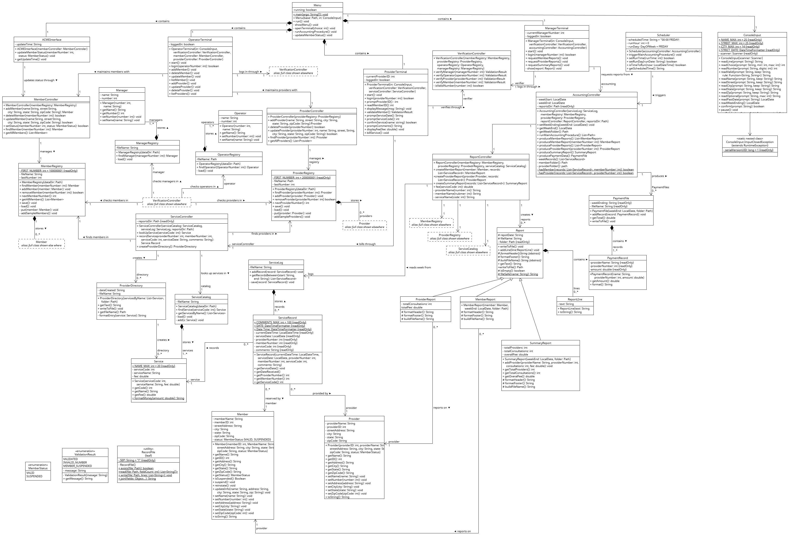

# CS200 ChocAn Project Team 6

This is the repository Team 6 will be using for their ChocAn project files

## Class Diagram of ChocAn System

## File Structure

- 00_Meeting_Notes: Contains the notes for every meeting held as a group.
- 01_Reports: Contains the reports submitted for Project 1-3.
- 02_Diagrams: Contains the uml diagrams created for each stage of the project in both uxf and pdf form.
- 03_Code: Contains the source code for the ChocAn Data Processing Software created.

## Authors

- Aaron Suarez - [ahsuarez-ua](https://github.com/ahsuarez-ua)
- Jacob Wilson - [jrwilson29](https://github.com/jrwilson29)
- Gabriel Mckinney - [gabemckinney](https://github.com/gabemckinney)
- Peyton Hardy - [pchardy](https://github.com/xaliation)
